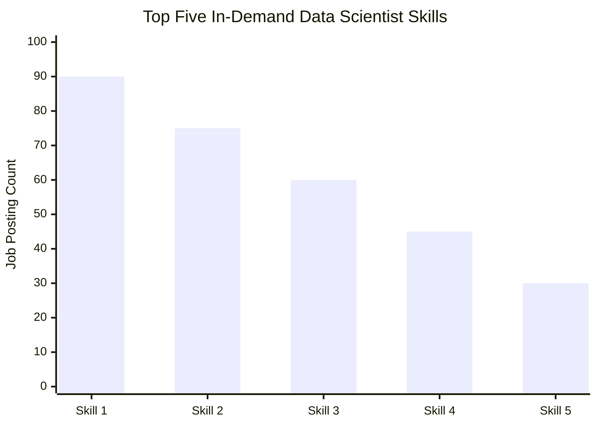

# Introduction
Dive into the data job market, with a focus on data science roles! This project explores job postings, salaries, and in-demand skills to uncover insights into the opportunities available in the data industry. Using SQL and PostgreSQL, I analyze job market data to identify trends, understand salary patterns, and discover the skills employers seek in data professionals. The goal is to turn raw job posting data into meaningful insights that can help job seekers make informed career decisions and understand the evolving demands of the data science field..

Project Repository: [SQL Project on GitHub](https://github.com/MuthomiLeslie/sql_project)


# Tools I Used

- **PostgreSQL:** Used to store, organize, and analyze job posting data using SQL queries.
- **SQL:** Used to filter, join, aggregate, and analyze job postings, salaries, and skills to answer key questions about the data science job market.
- **Visual Studio Code:** Used to write, edit, and organize SQL scripts.
- **Git and GitHub:** Used for version control, tracking project changes, and sharing the project publicly.
# The Analysis


The analysis focused on five key questions about the data science job market. SQL filtering, joins, aggregation, and sorting were used to narrow the dataset and identify relevant job opportunities and in-demand skills.

## 1. What are the top-paying remote Data Scientist jobs?

The first query filters job postings to include only Data Scientist roles, remote opportunities located in `Anywhere`, and jobs with reported annual salaries. The results are sorted from the highest to the lowest salary, returning the top 50 job postings.

```sql
SELECT
    job_postings_fact.job_id,
    job_title,
    company_dim.name AS company_name,
    job_location,
    job_schedule_type,
    salary_year_avg,
    job_posted_date
FROM job_postings_fact
LEFT JOIN company_dim
    ON job_postings_fact.company_id = company_dim.company_id
WHERE
    job_title_short = 'Data Scientist'
    AND job_location = 'Anywhere'
    AND salary_year_avg IS NOT NULL
ORDER BY salary_year_avg DESC
LIMIT 50;
```

# The Analysis

This analysis examines salary opportunities, technical skill requirements, and the relationship between skill demand and average salary in the Data Scientist job market.

## 1. Top-Paying Remote Data Scientist Jobs

The analysis identified the highest-paying remote Data Scientist positions by filtering for remote jobs with reported annual salaries and ranking them in descending order.

[View SQL Query](project_sql/1_top_paying_jobs.sql)

### Results

| Job Title | Company | Annual Salary ($) |
|---|---|---:|
| Replace with query result | Replace with company | Replace with salary |
| Replace with query result | Replace with company | Replace with salary |
| Replace with query result | Replace with company | Replace with salary |

### Key Insight

The results identify the highest reported annual salaries among the remote Data Scientist postings in the dataset. Comparing job titles and employers helps show the range of compensation available across different positions.

## 2. Skills Required for the Highest-Paying Jobs

This analysis connects the 50 highest-paying remote Data Scientist jobs with their associated skills. The results help identify the technical capabilities appearing in these high-paying positions.

[View SQL Query](project_sql/2_top_paying_job_skills.sql)

### Key Findings

- Compare how frequently programming languages appear across the selected job postings.
- Examine the presence of database, cloud, and big-data technologies.
- Identify specialized machine-learning tools associated with the highest-paying positions.

### Skills Summary

| Skill | Number of Job Postings |
|---|---:|
| Replace with query result | Replace with count |
| Replace with query result | Replace with count |
| Replace with query result | Replace with count |

## 3. Most In-Demand Data Scientist Skills

This analysis ranks skills according to the number of Data Scientist job postings that request them. Skill identifiers connect job postings to the skills dimension table, allowing demand to be summarized by skill.

[View SQL Query](project_sql/3_top_demanded_skills.sql)

### Results

| Rank | Skill | Number of Job Postings |
|---:|---|---:|
| 1 | Replace with query result | Replace with count |
| 2 | Replace with query result | Replace with count |
| 3 | Replace with query result | Replace with count |
| 4 | Replace with query result | Replace with count |
| 5 | Replace with query result | Replace with count |

### Demand Comparison



*Note: Replace the illustrative labels and values with the actual top five skills and counts from PostgreSQL.*

### Key Insight

The most frequently requested skills indicate which technical capabilities appear most often in the job postings analyzed. These results can help job seekers prioritize skills based on employer demand.

## 4. Skills Associated with the Highest Average Salaries

This analysis calculates the average reported annual salary associated with each skill among Data Scientist job postings. The results are sorted from the highest to the lowest average salary.

[View SQL Query](project_sql/4_top_paying_skills.sql)

### Results

| Rank | Skill | Average Annual Salary ($) |
|---:|---|---:|
| 1 | Replace with query result | Replace with salary |
| 2 | Replace with query result | Replace with salary |
| 3 | Replace with query result | Replace with salary |
| 4 | Replace with query result | Replace with salary |
| 5 | Replace with query result | Replace with salary |

### Key Insight

Skills with higher average associated salaries may be valuable in specialized roles. However, average salary alone does not establish that a skill causes higher pay, and the results may be influenced by the types and seniority of jobs in which each skill appears.

## 5. Skills Offering a Combination of Demand and Salary

This analysis combines skill demand with average salary to identify skills that are both frequently requested and associated with competitive compensation.

[View SQL Query](project_sql/5_optimal_skills.sql)

### Results

| Skill | Job Posting Count | Average Annual Salary ($) |
|---|---:|---:|
| Replace with query result | Replace with count | Replace with salary |
| Replace with query result | Replace with count | Replace with salary |
| Replace with query result | Replace with count | Replace with salary |

### Key Insight

Comparing demand and salary provides a broader view of the Data Scientist job market than considering either measure alone. Skills that perform well on both measures may be worth prioritizing when planning professional development.

## Overall Findings

The five analyses examine the job market from complementary perspectives: compensation, skill requirements, employer demand, and the relationship between demand and salary. Together, they provide a structured basis for understanding the technical skills associated with Data Scientist opportunities.

The final conclusions should be updated after validating all five queries and inserting their actual results.

# What I Learned

Through this project, I applied SQL to analyze Data Scientist job postings, salaries, and in-demand technical skills. The analysis demonstrates how structured querying can transform raw job market data into useful insights for career planning and decision-making.

- **Data Filtering:** Used `WHERE`, `IS NOT NULL`, and multiple conditions to isolate relevant job postings based on job title, location, and salary availability.
- **Joining Tables:** Used `LEFT JOIN` and `INNER JOIN` to combine job postings, company information, and skill data across relational tables.
- **Data Aggregation:** Applied `COUNT()` and `AVG()` with `GROUP BY` to measure skill demand and calculate average salaries.
- **Advanced SQL Techniques:** Used Common Table Expressions (CTEs) to organize complex queries into manageable steps.
- **Sorting and Ranking:** Used `ORDER BY` and `LIMIT` to identify top-paying jobs, frequently requested skills, and skills associated with higher average salaries.
- **Data-Driven Decision-Making:** Compared salary and demand metrics to investigate which technical skills may offer valuable opportunities in the Data Scientist job market.
- **Data Validation:** Recognized the importance of checking query accuracy, handling missing salary information, and validating results before drawing conclusions.

# Conclusions

This project analyzed the Data Scientist job market through five key areas: top-paying remote positions, skills associated with high-paying jobs, the most in-demand skills, skills linked to higher average salaries, and the combination of skill demand and compensation.

The analysis provides a structured view of how employers advertise Data Scientist opportunities and the technical capabilities associated with those roles.

Key conclusions include:

- **Salary opportunities:** Ranking job postings by annual salary helps identify positions offering the highest reported compensation within the dataset.
- **Technical skill demand:** Counting skill requirements across job postings helps identify the capabilities most frequently requested by employers.
- **Salary and specialization:** Comparing average salaries by skill can highlight technologies associated with higher-paying positions, although the relationship does not establish causation.
- **Career prioritization:** Considering both job posting frequency and average salary provides a more balanced basis for evaluating which skills to develop.
- **Evidence-based career planning:** SQL analysis can support career decisions by replacing assumptions with measurable patterns from job market data.

Overall, the project demonstrates how SQL and PostgreSQL can be used to investigate real-world employment questions, analyze relational data, and communicate findings that support informed career planning. The results reflect the dataset analyzed and may not represent the entire job market.